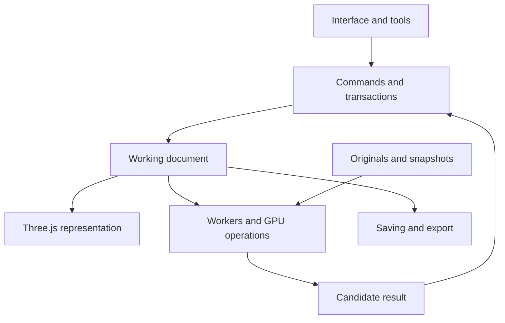

# AssetFixer — Detailed Technical Specification

**Version:** 1.0  
**Date:** November 26, 2026  
**Status:** specification for design and phased implementation  
**Working name:** AssetFixer  
**Product type:** local browser-based editor for existing 3D assets  
**Primary workflow:** Tripo / Meshy / another generator → asset cleanup → export to a game engine, primarily Unity.

> This document consolidates the requirements discussed. It is a development specification, not a description of an already implemented application. The stated performance and accuracy values are target acceptance criteria. The suitability of libraries for the actual model set must be established through prototypes and tests.

## Contents

1. [Purpose and Expected Outcome](#sec-01)
2. [Terminology and Required User Workflows](#sec-02)
3. [Full-Version Scope and Project Boundaries](#sec-03)
4. [Technical Platform and Library Selection](#sec-04)
5. [Architecture and Data Model](#sec-05)
6. [Project, Source Files, History, and Background Operations](#sec-06)
7. [Import, Export, and Unity Compatibility](#sec-07)
8. [Interface and Controls](#sec-08)
9. [Basic Geometry Editing](#sec-09)
10. [Hole Repair and Surface Construction](#sec-10)
11. [UV Editor and Automatic Unwrapping](#sec-11)
12. [Minimal 2D Texture Editor](#sec-12)
13. [Painting Directly on the Model](#sec-13)
14. [Texture Rebaking and Transfer](#sec-14)
15. [Extracting Individual Static Objects](#sec-15)
16. [Skeleton Editing and Heavyset Characters](#sec-16)
17. [Weight Editing](#sec-17)
18. [Posing and Ten Diagnostic Animations](#sec-18)
19. [Asset Diagnostics and Status Report](#sec-19)
20. [Performance, Compatibility, and Resilience](#sec-20)
21. [Implementation Stages](#sec-21)
22. [Test Data and Acceptance Criteria](#sec-22)
23. [Development Deliverables and Implementation Rules](#sec-23)
24. [Risks and Decisions Requiring a Prototype](#sec-24)
25. [Verified Technical Sources](#sec-25)

---

<a id="sec-01"></a>

## 1. Purpose and Expected Outcome

### 1.1. Product Objective

Develop a compact, understandable editor for refining existing models. The user opens a generated asset, fixes specific geometry, texture, UV, or skinning defects, and obtains an asset suitable for a game.

The primary workload is low-poly / mid-poly models, including models with coarse pixel textures, static props, and humanoid characters. The editor must not require installing a large 3D package or using paid cloud services.

Two complete workflows are required:

- **Static assets:** isolate an individual item from a combined generation, fix its shape and holes, prepare its own UVs and textures, set its pivot, and export it.
- **Characters:** touch up textures and UVs and, where necessary, geometry, joint placement, and weights; test poses and movements; export with the skeleton.

### 1.2. Principles

1. Each short development iteration must produce a useful result.
2. Models and textures are processed on the user's device.
3. Original files remain unchanged inside the project.
4. Document changes use explicit commands with Undo/Redo.
5. Rebaking uses a specific source snapshot; changing UVs must not silently discard existing paint edits.
6. Unsupported data is disclosed before an export that may be incomplete.
7. View modes, diagnostic poses, and the helper grid do not change the exported asset.
8. The interface exposes tools for the current task; the geometry core remains independent of the interface.
9. Validate the complete "import → edit → export → Unity" path first, then expand functionality.
10. Implementation limitations are stated explicitly. Buttons that simulate results instead of providing a working tool are not acceptable.

### 1.3. Definition of a Complete Product

The full **V1** release must cover every mandatory requirement in Section 2, including rigs, weights, manual polygon construction, multiple hole-filling methods, ten animations, and FBX export.

The early usable build, **V0.1**, covers texture cleanup. It is an intermediate delivery, not a replacement for the full scope.

Do not commit to schedules in days before the technical prototyping stage. In particular, FBX export and complex surface repair cannot be estimated reliably without real files.

<a id="sec-02"></a>

## 2. Terminology and Required User Workflows

### 2.1. Terminology

| Term | Meaning in this project |
|---|---|
| Original asset | Immutable input files and the initial import result |
| Working document | The current editable state of objects, geometry, textures, and skeletons |
| Source snapshot | A fixed revision of the model and textures used as the source for data transfer |
| Topological vertex | A vertex of the editable surface, connected to edges and faces |
| Face corner / corner | A vertex's participation in a particular face; it may have its own UVs and normal |
| Render vertex | An entry in GPU buffers; one topological vertex may correspond to several render vertices |
| UV island | A connected region of the unwrap with continuous UVs along shared edges |
| Rest pose | The base skeleton configuration relative to which movements are defined |
| Bind pose | The configuration used to bind the mesh to the skeleton; it may differ from the first animation frame |
| Pose | The current diagnostic or animated pose |
| Rebake | Transfer of available texture data to another UV layout or surface |
| Round-trip | Import and re-export followed by verification of semantic preservation |
| Full V1 | The complete mandatory user feature set, delivered across several stages |

### 2.2. User Requirements Matrix

**USR-xx** identifiers are used to verify implementation completeness.

| ID | Requirement | Implementation sections | Status |
|---|---|---|---|
| USR-01 | HTML5 editor, minimal interface, local processing | 4, 8, 20 | Required in V1 |
| USR-02 | Model import and export, including FBX | 7 | Required in V1; early technical gate |
| USR-03 | Brush painting directly on the model | 13 | Required in V1 |
| USR-04 | Edit the texture image with a UV overlay; brush and clone stamp | 12 | Required in V1 |
| USR-05 | Manual UV editing: islands, individual vertices, edges, and faces | 11 | Required in V1 |
| USR-06 | Basic editing of model vertices, edges, and polygons | 9 | Required in V1 |
| USR-07 | Rebake textures after editing or completely regenerating UVs | 14 | Required in V1 |
| USR-08 | Automatic unwrapping with a suitable browser-compatible algorithm | 11 | Required in V1; select the backend after prototyping |
| USR-09 | Paint and adjust bone weights | 17 | Required in V1 |
| USR-10 | Edit rigs, including fitting them to heavyset characters | 16 | Required in V1 within the defined limits |
| USR-11 | Approximately ten built-in animations for quick humanoid testing | 18 | Required: ten clips |
| USR-12 | Manually rotate bones and quickly switch between preset poses | 18 | Required in V1 |
| USR-13 | Extract individual static meshes from a combined generation | 15 | Required in V1 |
| USR-14 | Give the extracted object its own textures without an unnecessary shared atlas | 14, 15 | Required in V1 |
| USR-15 | Automatic and manual hole filling with multiple surface generators | 10 | Required in V1 |
| USR-16 | Build several polygons from existing points | 9, 10 | Required in V1 |
| USR-17 | Continue work without damaging the original or introducing unnecessary, unexplained changes | 5–7, 22 | Required; guarantee limited to supported data |

### 2.3. End-to-End User Stories

**SC-01. Touch up a static prop.** Open a model, select a material, open its image with a UV overlay, sample a color with the eyedropper, fix a defect with the brush/stamp, inspect the result in 3D, and save the PNG and model.

**SC-02. Replace an inconvenient UV layout.** Snapshot the current model and textures, create a new UV layout, edit its islands, rebake color and other maps in use, compare the appearance, and export.

**SC-03. Fix a character.** Open a skinned model, reposition joints in Rig Edit mode, correct weights, test squatting and raising the arms, adjust diagnostic offsets for a bulky body, and export.

**SC-04. Separate a set of props.** Select one or more connected components, combine them into a logical object, extract it, repack its UVs, obtain separate maps, position the pivot at the base, and export. Repeat or process a batch.

**SC-05. Repair a local defect.** Find an open boundary, choose a patch generator, inspect the mesh and self-intersections, apply the patch, manually add triangles if necessary, create UVs, and fill in the new region's color.

**SC-06. Resume work.** Save the project, close the editor, reopen it, and continue with the same objects, textures, poses, and operation settings.

<a id="sec-03"></a>

## 3. Full-Version Scope and Project Boundaries

### 3.1. Required V1 Modules

- Projects and edit history.
- Import/export and compatibility reports.
- 3D viewport, object list, properties, and selection.
- Basic topology editing and local shape correction.
- Hole repair and small patch construction.
- UV editor, automatic unwrapping, and packing.
- Minimal 2D texture editor and 3D brush.
- Rebaking after UV changes and transfer to a modified surface.
- Object extraction with individual atlases.
- Editing of existing skeletons and weights.
- Manual poses, preset poses, and ten diagnostic animations.
- Autosave, diagnostics, and export validation.

### 3.2. Additional Features Beyond the Required Set

The following ideas were discussed as possible extensions, but must not delay V1:

- full automatic quad retopology;
- advanced sculpting and global remeshing;
- LOD generation, colliders, and bulk optimization presets;
- multilayer painting, Photoshop-like filters, and intelligent healing;
- AI inpainting, neural removal of baked-in lighting, and generator APIs;
- a full animation editor with a keyframe timeline, IK rigs, and constraints;
- general-purpose character autorigging from scratch;
- physical simulation of soft bodies, bellies, and clothing;
- automatic corrective blend shapes;
- collaboration, accounts, and cloud storage;
- a mobile interface and touch-only controls;
- a separate desktop wrapper;
- a byte-level patcher for arbitrary FBX files that preserves all unknown properties;
- arbitrary reordering of previously applied topology operations with guaranteed recomputation of the entire subsequent history.

### 3.3. Keeping Scope Manageable Without Losing the Outcome

For the first full version, editing ordinary polygonal surfaces and standard linear skinning is sufficient. Curves, NURBS, procedural materials, and custom deformers are not editable as native systems.

Complex input data must use an explicitly limited mode: viewing, original-file export, texture editing, or rejection of an unsupported operation. Silent data removal is prohibited.


<a id="sec-04"></a>

## 4. Technical Platform and Library Selection

### 4.1. Base Stack

| Subsystem | Solution |
|---|---|
| Language | TypeScript with strict typing |
| Build | Vite; dependency versions pinned by a lockfile |
| 3D | Three.js; WebGL2 as the baseline renderer |
| Interface | DOM/CSS and small TS components; no mandatory large UI framework |
| 2D presentation | Canvas2D for the texture/UV interface; GPU passes for heavy operations |
| Geometry core | A custom data model and operations on it |
| Heavy CPU algorithms | Web Workers; WASM where necessary |
| Project | A custom .assetfixer container |
| Autosave | IndexedDB for metadata; OPFS or IndexedDB for binary data |
| Delivery | Static files served over HTTPS or localhost |
| Offline operation | Application cache and local decoders after the initial installation/load |
| Primary target environment | Desktop Chrome/Edge on Windows |
| Secondary environment | Desktop Firefox/Safari and macOS, after compatibility testing |

WebGPU is not a mandatory dependency for V1. An optional accelerated backend must not remove core functionality from WebGL2.

### 4.2. Libraries and Selection Status

| Library | Purpose | Established information | What must be verified |
|---|---|---|---|
| Three.js | Viewport, materials, controls, basic loaders/exporters | Public documentation and source code are available [S01], [S02], [S03], [S04] | A suitable pinned version and real assets |
| xatlas | Automatic UVs and packing | A parameterization library; MIT [S05] | Quality on target models and correct remapping |
| xatlas-three / a custom xatlas WASM wrapper | Browser-based unwrapping | A WASM/worker wrapper exists; MIT [S06] | Compatibility with the selected Three.js version and access to complete output data |
| Earcut | Triangulation of a projected planar contour | A 2D JS triangulator; ISC [S07] | Contour validity conditions and absence of degenerate faces |
| three-mesh-bvh | Picking, spatial queries, projection | Public BVH API [S08] | Stable triangle IDs, posed picking, and the selected version |
| Comfy-Org/fbx-exporter-three | Candidate for FBX export | An actual TS binary exporter; MIT [S09] | Full round-trip, skeletons, animations, and materials in Unity |
| meshoptimizer | Optional simplification/decoding | Official library and JS/WASM components [S10] | Attribute preservation and compatibility; it does not replace UV tools or retopology |
| Custom GPU passes | Paint, UV rebake, masks, dilation | A part of the editor to be designed | Color accuracy, seams, memory, and GPU compatibility |

**Do not treat xatlas as a ready-made UV editor.** Selection, movement of individual UV vertices, seams, Stitch, and interactive Relax are separate application features.

**Do not treat an FBX exporter as a compatibility guarantee.** README claims justify a prototype; they do not constitute acceptance results.

### 4.3. Relationship to the Tripo Viewer

Do not base the project on extracted proprietary Tripo client code. This specification does not treat the current Tripo viewport's technology stack as officially confirmed.

Public libraries used to build similar viewers may be used, and useful workflows may be studied. The editor must not depend on Tripo's internal API, markup, or authentication.

Three.js Editor may serve as a source of ideas and individual compatible components after license review. Forking the entire editor is not a required architecture.

### 4.4. Dependency Policy

Record the version/commit, license, and selection rationale for every integrated library. Ship decoders and WASM files with the application rather than loading them from a mutable third-party CDN during editing.

Do not include CGAL by default. It is a possible research foundation for surface repair, but the browser build, size, available APIs, and redistribution terms of the selected packages must be checked separately [S11].

<a id="sec-05"></a>

## 5. Architecture and Data Model

### 5.1. Separation of Responsibilities



Three.js handles rendering and GPU interaction. The working document, not the Three.js object tree, is the source of truth.

Change flow: input → command → precondition checks → result computation → validation → atomic commit → view update. Direct geometry mutation from a button handler that bypasses history is prohibited.

### 5.2. Logical Entities

| Entity | Minimum data |
|---|---|
| Project | Schema version, revision, settings, references to resources and originals |
| SceneObject | Stable ID, name, parent ID, local transform, visibility, mesh/material/skin references |
| MeshAsset | Vertices, faces, attributes, adjacency, element provenance |
| Vertex | ID, position, supported morph deltas; weights are addressed by this ID in SkinBinding |
| Face | ID, ordered corners, material ID |
| Corner | Vertex ID, UVs by channel, normal/smoothing discontinuity, additional corner data |
| UVVertex | A group of corners in one channel sharing a continuous UV vertex; its own ID |
| Edge | Endpoints, incident faces, seam/sharp/protected flags |
| TextureAsset | ID, dimensions, channel/semantics, color space, pixels, version, source |
| MaterialAsset | Maps, scalar parameters, texture transforms, UV channels, alpha mode |
| SkeletonAsset | Stable bone IDs, hierarchy, local base transforms |
| SkinBinding | Mesh ID, Skeleton ID, bind matrices, the sole store of weights by Vertex ID, and binding mode |
| AnimationClip | Stable binding IDs, curves, duration, source, calibration version |
| PoseAsset | Local transforms by bone ID, skeleton version, name |
| HumanoidProfile | Anatomical role mapping, axes, calibration, and offsets |
| BakeRecipe | Source snapshot, target revision, maps, parameters, coverage, and status |
| SelectionState | Objects/vertices/edges/faces/corners, active element, masks |
| DiagnosticIssue | Type, severity, element references, suggested action |

### 5.3. Topology and Render Buffers

**CORE-01.** Maintain stable element IDs. An index in a GPU array is not a document ID.

**CORE-02.** Separate geometric vertices from corner attributes. A UV seam or hard normal may require several render vertices, but must not split a logically continuous surface when a vertex is moved.

**CORE-03.** Preserve known connectivity on import. Do not weld every coincident position: touching objects, clothing, fingers, and inner shells may be independent.

**CORE-04.** If the loader has lost information required to reconstruct connectivity unambiguously, use conservative reconstruction. Display ambiguous boundaries separately; restore connectivity through an undoable command with a preview.

**CORE-05.** Allow non-manifold geometry to be loaded. The representation must store an arbitrary number of incident faces per edge or provide a separate layer for problematic regions. A conventional half-edge structure with a single twin and no exception handling is insufficient.

**CORE-06.** The core may store triangles and simple polygons. Rendering uses deterministic triangulation with the mapping `renderTriangle → faceId + localTriangle`. Imported triangles are not automatically treated as original quads.

**CORE-07.** Every topology operation returns an element provenance/replacement map. New vertices retain the source vertices or barycentric coordinates needed to transfer attributes.

**CORE-08.** BVH construction, packing, and optimizers must not silently break triangle-ID correspondence. The adapter must account for possible index reordering and library modes [S08].

**CORE-09.** A UVVertex groups corners that are continuously connected within one UV island. Moving it updates the entire group. Coincident coordinates in different islands do not create a shared UVVertex; a seam separates the groups.

**CORE-10.** SkinBinding is the sole owner of weights. Render attributes and vertex panels obtain them by Vertex ID; duplicate editable weight stores in Vertex are prohibited.

### 5.4. Attribute Preservation

Define each operation's behavior for:

- positions and connectivity;
- all supported UV channels;
- normals and hard edges;
- tangents/handedness;
- the material of each face;
- vertex colors;
- skin weights and bone IDs;
- morph targets;
- provenance and selection masks.

Do not recompute everything globally for a local edit. For example, moving UVs must not change skin weights, and a color brush must not rebuild the mesh.

When normals/tangents need recomputation, update dependent data and flag affected normal maps. Do not replace preserved original normals automatically without a reason.

V1 may block a particular operation on a mesh with unsupported morph targets. It may offer an explicit working copy without morphs; the original remains available. Silent loss of morphs is prohibited.

### 5.5. Coordinates and Numerical Data

- Use a right-handed internal coordinate system with +Y up.
- Store the object's "forward" direction in its profile; do not infer it from camera orientation.
- Preserve metadata describing units and original axes.
- Use one consistent coordinate-conversion adapter for geometry, skeletons, bind matrices, and animations.
- Scaling for convenient viewing must not change the document's physical dimensions.
- Handle negative scale with due regard for winding, normals, and tangent sign.
- Diagnose non-uniform scale, shear, and singular matrices. If an operation requires the absence of shear, make that an explicit precondition.
- Validate all arrays for NaN, Infinity, invalid indices, and degenerate values.

### 5.6. Minimum Module Contracts

```ts
interface Command {
  id: string;
  label: string;
  baseRevision: number;
  affectedResources: string[];
  validate(document: AssetDocument): ValidationResult;
  execute(document: AssetDocument): CommandResult;
  undo(document: AssetDocument): void;
}

interface GeometryOperationResult {
  mesh: MeshData;
  correspondence: ElementCorrespondence;
  affectedFaces: string[];
  warnings: DiagnosticIssue[];
}

interface BakeRequest {
  sourceSnapshotId: string;
  targetRevision: number;
  targetObjectIds: string[];
  channels: TextureSemantic[];
  settings: BakeSettings;
}

interface ExportReport {
  format: string;
  exportedObjectIds: string[];
  preserved: string[];
  converted: string[];
  unsupported: string[];
  warnings: DiagnosticIssue[];
}
```

These define responsibility boundaries, not mandatory class names. The implementation may refine the structures while preserving the invariants.

<a id="sec-06"></a>

## 6. Project, Source Files, History, and Background Operations

### 6.1. Three Data States

**PROJECT-01. Original.** The source FBX/GLB files, external maps, and initial imported representation must remain unchanged.

**PROJECT-02. Working.** The editable model and current textures.

**PROJECT-03. Operation Source.** An immutable source snapshot selected for a specific bake, weight transfer, or comparison.

By default, the bake source snapshot must capture the state immediately before the UV change. If the user previously painted an eye or corrected a blemish, those edits must be included in the source.

Copying Three.js objects alone does not constitute a complete snapshot: editable geometry, materials, and textures may still be shared references. Resource ownership must be explicit [S12].

### 6.2. The .assetfixer Format

The proposed format is a ZIP container with a versioned manifest and binary resources:

| Path Inside the Container | Contents |
|---|---|
| manifest.json | Schema version, objects, resources, references, and settings |
| originals/ | Original input files |
| geometry/ | Working meshes and required correspondences |
| textures/ | Current images and channel metadata |
| skeletons/ | Skeletons and bindings |
| animations/ | Original/adapted clips, profiles, and poses |
| snapshots/ | Pinned operation sources |
| recipes/ | Unwrap/bake/extract parameters |
| reports/ | Latest diagnostics and export reports |

The exact binary format will be refined during implementation. Reference integrity and resource hashes must be checked; identical blobs must not be duplicated.

A saved project must open without the source files on disk and without network access.

### 6.3. Saving and Recovery

- `Save Project` saves the current working document to .assetfixer.
- `Save As` creates an independent copy.
- Autosave must create a new committed checkpoint after a command completes, with a default delay of 5 seconds.
- The document must not be serialized in the middle of an unfinished stroke or topology transaction.
- When closing with unsaved changes, use the browser's available notification mechanism.
- After a crash, offer the latest intact autosave; a corrupted entry must not be selected automatically.
- Available quota must be checked; if space is insufficient, offer to save the project as a file.
- OPFS/IndexedDB must not be treated as a guaranteed backup: the user or browser can clear site storage [S13], [S14].
- Deleting old autosaves must not delete pinned sources required by the current project.
- Project version migrations must be supported, with a clear rejection of unknown newer schemas.

### 6.4. Undo/Redo

**HIST-01.** One stroke must be one operation, even when it affects multiple UV islands.

**HIST-02.** Fill, Extract, and UV + Bake must be applied atomically: Undo restores geometry, maps, materials, and references together.

**HIST-03.** Camera navigation and display changes must not clutter the document edit history.

**HIST-04.** Image history must store modified tiles/regions rather than a full copy of every 4K map for each pointer event.

**HIST-05.** History must have a configurable memory budget. The initial target budget is 256 MiB; actual availability must be checked.

**HIST-06.** When the budget is exhausted, create a checkpoint and discard only old undo history. The available undo depth must be visible to the user.

**HIST-07.** Loading an .assetfixer file must restore the current working document. Restoring the entire previous Undo history is not required for V1; the interface must make this clear.

**HIST-08.** Do not promise unrestricted reordering of past operations. Topology changes can make subsequent strokes and selections inapplicable.

### 6.5. Background Operations

Every long-running job must have a `jobId`, `baseRevision`, input resource hashes, progress, status, and a cancellation mechanism.

The result must first be created separately. Before applying it, check that the input revision is still current. If the user has changed the data in the meantime, an outdated result must not automatically replace the newer edits.

On cancellation/error, the working document must remain unchanged. For a non-cancellable WASM call, terminating and recreating the worker is acceptable; the incomplete result must be discarded.

BVH, mask, tangent, unwrap, and bake caches must have versioned dependencies. Invalidation must be part of the command.

### 6.6. Rebaking After Painting

Rerunning an old bake recipe can destroy later paint edits. Therefore, before replacing maps:

1. Compare versions and check for subsequent edits.
2. Offer a new set of maps for comparison or a new source captured from the current state.
3. Do not silently overwrite a manually edited texture.
4. Preserve the ability to undo the entire replacement.

<a id="sec-07"></a>

## 7. Import, Export, and Unity Compatibility

### 7.1. Formats

| Format | V1 Import | V1 Export | Conditions |
|---|---|---|---|
| Binary FBX / supported ASCII | Yes | Binary FBX | Validated subset; conversion report |
| GLB / glTF 2.0 | Yes | GLB; glTF + resources if needed | Explicit extension support matrix |
| PNG | Yes | Yes | Primary format for editable maps |
| JPEG | Yes | Not the primary format | PNG by default after editing |
| OBJ + MTL | Desirable extension | Desirable extension | Must not block mandatory FBX/GLB support |
| .assetfixer | Yes | Yes | Complete native project |
| ZIP containing models and maps | Yes | Yes, for a set of exports | Size limits and safe path resolution |

The actual FBXLoader limitations and GLTFLoader extension support depend on the selected version. For example, the documentation explicitly identifies morph normals as unsupported by FBXLoader [S01], [S02].

### 7.2. Import

**IO-01.** Support file drag-and-drop, folders where supported by the browser, a file picker, and ZIP.

**IO-02.** Load a model together with its external maps. Match by relative path and name; ambiguity must prompt a choice rather than an arbitrary substitution.

**IO-03.** Show a list of materials and missing textures. Allow manual file assignment.

**IO-04.** External URLs in the model must not be loaded automatically. Selected local resources are preferred.

**IO-05.** After import, show the counts of objects, triangles, materials, UV sets, textures, bones, and clips, along with detected limitations.

**IO-06.** Do not automatically optimize, weld, decimate, or change the asset's physical orientation/size or map resolution without an explicit command. Internal conversion of the axis and unit representation is allowed: the adapter must record it and preserve the original coordinate semantics for display and export.

**IO-07.** Compressed GLB files must be decoded locally. Support at least the meshopt/quantization cases actually encountered in the test corpus; support Draco/KTX2 when corresponding inputs and adapters are available [S02].

**IO-08.** Before constructing the working representation, check for known unsupported entities against the capability registry. Complete detection of arbitrary vendor-specific FBX properties is not guaranteed. For FBX, consider ufbx as an independent inspector or the primary import adapter where the loader loses required topology/attributes [S15].

### 7.3. Three Different Ways to Save

1. **Export Textures.** Save only the selected PNG files. This is the primary path when only color has changed and there is no need to modify the FBX.
2. **Export Model.** Create a new FBX/GLB from the supported working representation.
3. **Export Original.** Export the original input files unchanged.

Model export must not be described as lossless. Byte-for-byte identity or preservation of unknown FBX entities is not promised.

For embedded FBX textures, exporting new PNG files alone does not replace the embedded maps. In this case, the user must receive explicit instructions for assigning the maps in the engine or use full model export.

### 7.4. Export Selection and Resources

- Export the entire scene, selected objects, or a standalone extracted asset.
- Include only the dependencies of the selected objects.
- Exclude helper grids, preview lights, gizmos, diagnostic bones, and the UV overlay.
- Inclusion of original, adapted, and diagnostic clips must be configured separately.
- Diagnostic clips must be excluded from the game asset by default.
- Texture size, filtering, packing, and channel conversion must not change silently.
- For FBX, provide external PNG files and a material manifest; embedding is an additional mode that must be validated.
- For GLB, check alpha modes, texture transforms, UV channels, and the PBR maps in use.
- The exported pose must not be determined by the current viewport frame: the base binding and clips must come from the working document.

### 7.5. FBX Adapter

The primary candidate is the Comfy exporter [S09]. At the time of verification, its documentation identifies limitations in coordinate conversion and in representing PBR through FBX Phong.

Adapter requirements:

- Pin the version/commit.
- Prohibit unsafe `bakeSpaceTransform` for characters and complex hierarchies until the correctness of all dependent matrices/curves has been demonstrated.
- Convert axes/units consistently.
- Do not promise identical PBR materials in FBX and Unity.
- Record map semantics in the manifest: BaseColor, Normal, Roughness, Metallic, AO, Emissive, Alpha.
- Export joints, weights, bind matrices, and animations as an interdependent set.
- Do not delete a track by name without updating stable binding IDs.
- Provide a loss/conversion report before export.

### 7.6. Validation in Unity

Primary validation must use Unity 2022.3 LTS from the user's working environment; additional validation must use an agreed Unity 6 version. The report must record the exact Editor and importer versions.

Sequence:

1. Generic import: geometry, orientation, scale, normals, materials, skinning, and original clips.
2. Humanoid import: mapping, Avatar, calibration, and motion playback.
3. Check the animation at multiple time points.
4. Check a standalone static asset with its pivot and individual maps.

GLB must not be assumed to be automatically supported by every clean Unity installation. GLB validation must record the glTF importer used; FBX remains the mandatory standard Unity path.

### 7.7. Compatibility Gate

Before main development, prepare several real Tripo/Meshy files and synthetic fixtures. Test import → export with no changes, then repeat after a small edit.

Reading the result with the same loader is insufficient. FBX validation requires Unity and an independent parser, such as ufbx [S15].

A separate fixture must test UV/hard-normal seams together with independent vertices at coincident positions. The origin of topology IDs must be demonstrated: if the loader does not preserve them, use data from another parser or explicit connectivity reconstruction. Correct connectivity cannot be promised while reconstructing it solely by welding identical coordinates.

If the selected exporter fails character tests, the adapter must be fixed or the backend replaced. Development of other modules may continue, but FBX character support remains a blocker for completion of the full V1. Replacing the requirement with “use GLB” does not count as fulfillment.


<a id="sec-08"></a>

## 8. Interface and Controls

### 8.1. Workspace

The main screen must contain:

- A top bar: project, import, save, Undo/Redo, export.
- On the left: objects, materials, and a bone tree when needed.
- In the center: the 3D viewport.
- On the right or in a split area: the texture image / UV view.
- A contextual settings panel for the active tool.
- A bottom status bar: selection, statistics, jobs, and warnings.
- An animation player only in character testing mode.

Panels must be resizable and collapsible. Layout options: 3D only, 2D only, 3D + Texture, 3D + UV. The last layout must be saved in user settings.

### 8.2. Modes

| Mode | Primary Drag Action | Main Panels |
|---|---|---|
| Object | Select and transform objects | Hierarchy, transforms, materials |
| Mesh | Select and transform elements | Vertex / Edge / Face, operations |
| Repair | Select boundaries and preview a patch | Contours, algorithm, parameters |
| UV | Select and edit UVs | 3D + UV |
| Paint | Paint on the surface or image | 3D + Texture, brush/stamp |
| Rig | Edit the base skeleton | Bones, binding, mirroring |
| Weights | Paint a bone's influence | Heatmap, weight brushes |
| Pose / Test | Rotate bones and test animations | Poses, clips, player |

Bake, Extract, and Export must be presented as operation panels/wizards. Not every action needs a permanent tab.

UV and Paint modes must be visually distinct: dragging on the image must not simultaneously move UVs and paint.

### 8.3. Viewport

**VIEW-01.** Orbit, pan, zoom; frame the selection or the entire model.

**VIEW-02.** Perspective/Orthographic; front/back/left/right/top/bottom.

**VIEW-03.** Textured PBR, Unlit Base Color, Solid, Wireframe, Wireframe Overlay, UV Checker, Normals, Weight Heatmap.

**VIEW-04.** Floor grid, axes, bounds; their state must not affect export.

**VIEW-05.** Neutral lighting, exposure, and background settings. Unlit mode is used to inspect color without lighting influence.

**VIEW-06.** Skeleton Overlay, bone X-ray, selected bone labels.

**VIEW-07.** Comparison with the original or a selected snapshot: toggle and side-by-side, using identical cameras.

**VIEW-08.** Isolate an object/selection, Hide/Unhide; selection through the surface must be enabled separately.

**VIEW-09.** Precise transform input; world/local axes and pivot selection: median, active element, cursor.

### 8.4. Selection

- Click, Shift to add/remove.
- Rectangle and Lasso.
- Select All / None / Invert.
- Select Connected and Select Boundary.
- Selection by material.
- Synchronized Face selection between 3D and UV.
- Separate corner/edge/face/island selection for UVs.
- Front-only by default; X-ray must be an explicit toggle.
- For linked geometry/material copies, show whether an edit affects one instance or a shared resource.

### 8.5. Initial Keyboard Shortcuts

| Command | Binding |
|---|---|
| Undo / Redo | Ctrl+Z / Ctrl+Shift+Z |
| Save Project | Ctrl+S |
| Select | Q |
| Move / Rotate / Scale | W / E / R in Mesh/Object/UV |
| Vertex / Edge / Face | 1 / 2 / 3 in Mesh/UV |
| Island | 4 in UV |
| Brush / Stamp | B / C in Paint |
| Stamp Source | Alt+Click in 2D |
| Temporary Eyedropper | I or a dedicated button |
| Frame Selection | F |
| Apply / Cancel Preview | Enter / Esc |
| Delete | Delete |
| Player Play/Pause | Space when the player/3D Test has focus |
| Pan 2D | Space+Drag when 2D has focus |
| Orbit 3D / Pan 3D | RMB-drag / MMB-drag |
| Zoom | Wheel |

Bindings must depend on focus and be configurable. Text input must not trigger commands. Use the Cmd equivalent of Ctrl on macOS. Stamp Alt+Click must not conflict with camera orbit.

<a id="sec-09"></a>

## 9. Basic Geometry Editing

### 9.1. Minimum Required Toolset

| ID | Tool | Behavior |
|---|---|---|
| MESH-01 | Vertex / Edge / Face selection | Select logical elements, not just GPU indices |
| MESH-02 | Move / Rotate / Scale | Gizmo, numeric input, axis constraints, pivot |
| MESH-03 | Delete | Explicitly delete faces or elements while showing affected neighbors |
| MESH-04 | Merge / Weld | Merge into a selected vertex, the average position, or within a tolerance; preview |
| MESH-05 | Create Face | Create a polygon from ordered existing vertices |
| MESH-06 | Split Edge | Add a vertex on an edge; update all incident faces together |
| MESH-07 | Connect / Split Face | Add a diagonal between valid vertices of the selected face |
| MESH-08 | Flip Edge | Use the other diagonal for a pair of compatible triangles |
| MESH-09 | Flip Normals | Change the winding of selected faces |
| MESH-10 | Recalculate Normals | Explicit recalculation that preserves specified hard edges |
| MESH-11 | Separate | Move selected faces into a separate object |
| MESH-12 | Select Connected | Expand the selection using actual connectivity |
| MESH-13 | Dissolve | Remove a valid edge and merge its adjacent faces |

### 9.2. Proposed Additional Repair Tools

The following tools remain in the plan as useful V1+ extensions, but are not independent blockers for the mandatory user feature set:

- Soft Selection with adjustable radius and falloff.
- Smooth Selection with a fixed-boundary option.
- Flatten Selection relative to a selected/averaged plane.
- Simple Extrude of a selected boundary or region to extend a small area.
- Subdivide a selected area while correctly maintaining compatibility with adjacent faces.
- Mirrored movement across a selected plane, with a matching tolerance.

These are shape correction tools; a sculpting system with dozens of brushes is not required.

### 9.3. Create Face / Poly Build

1. The user selects vertices in sequence or specifies their order in the preview.
2. With three vertices, show the proposed triangle and its normal direction.
3. With four vertices, show a quad with a visible triangulation diagonal.
4. For a longer contour, check for repeated vertices, self-intersection, and acceptable non-planarity.
5. If the order is ambiguous, do not guess silently: show the contour and allow the order to be changed.
6. The Flip button changes the winding.
7. Enter applies; Esc cancels.
8. Sequential construction mode allows the last edge to remain as the starting edge of the next face.

By default, prohibit duplicate faces, zero-area faces, intersecting contours, and unintended non-manifold edges. A separate, clearly identified mode is required for an exception permitted by validation.

### 9.4. Attributes of New Geometry

- A new vertex on an edge must interpolate weights, colors, and supported morph deltas.
- UVs must be interpolated independently for each corner channel; seams must not be welded.
- The material must be inherited from a selected adjacent face or assigned manually.
- A new surface must receive UVs through the selected local projection or be marked as requiring unwrapping.
- Normals/tangents must be updated only where their underlying basis has changed.
- Created faces must be added to a separate temporary mask for painting.
- Do not create T-junctions: splitting a shared edge must update all connected sides.

### 9.5. Module Acceptance Criteria

Moving a vertex of a cube with UV seams must not create a crack; hard normals must remain hard. Two touching independent parts must not be welded automatically. After Split Edge and Create Face, normals, UVs, material IDs, and weights must be valid. Undo must restore the entire original attribute set.

Character topology editing must take place in the base configuration; arbitrary editing of vertices on a mesh deformed by animation is outside V1.


<a id="sec-10"></a>

## 10. Hole Repair and Surface Construction

### 10.1. Boundary Detection

**REPAIR-01.** Find open boundary edges and assemble valid loops/chains.

**REPAIR-02.** Show contours in 3D and in a list: ID, length, diameter, edge count, approximate planarity, and reason for invalidity.

**REPAIR-03.** A UV seam on a connected surface must not be treated as a hole.

**REPAIR-04.** An open boundary must not automatically be classified as an error. A bottle opening, garment edge, sheet, or open mouth may be intentional.

**REPAIR-05.** The “Keep Open” flag must exclude a contour from automatic repair.

**REPAIR-06.** Show branching, self-intersecting, and ambiguous boundaries separately; do not run an algorithm designed for a simple contour on them.

### 10.2. Required V1 Surface Generators

| Method | Purpose | Parameters and Limitations |
|---|---|---|
| Planar / Triangle Fill | Nearly planar holes, soles, bottoms, lids | Plane selection/estimation, non-planarity tolerance; triangulation without new boundary points |
| Fan Fill | A small, simple hole with a valid center point | Center vertex, manual center adjustment; fan validity checks |
| Smooth Fill | A smooth organic patch | Density, iteration count, boundary pinning; custom implementation of refinement + constrained fairing |
| Grid Fill | A controllable regular patch | Four sides/corners, compatible segment counts; not arbitrary quad-filling of any contour |
| Bridge | Connect two suitable contours/chains | Starting pairs, direction, twist, segments; point-count mismatches must be corrected explicitly |
| Manual Face / Poly Build | Build several polygons from existing vertices | Vertex order, winding, local triangulation |

Planar Fill uses a local plane and 2D triangulation, such as Earcut. Passing XYZ to Earcut does not turn it into a spatial surface reconstruction algorithm [S07].

Smooth Fill and Grid Fill are separate geometry kernel tasks. In V1, they must work for the specified limited class of valid contours; universal reconstruction of arbitrarily damaged meshes is not required.

### 10.3. General Workflow

1. Select one or more contours.
2. Choose a method.
3. Display a colored wireframe preview of the new faces.
4. Adjust parameters.
5. Check normals, area, intersections, and the boundary.
6. Apply or cancel.
7. Automatically select the new faces for UV editing and painting.

The preview must not modify the working document. If the algorithm fails to converge or produces an invalid surface, the source must remain intact; the user must receive an explanation and another available method.

### 10.4. Automatic Filling

Auto Fill panel:

- Scope: selected object / selected contours.
- Maximum number of boundary edges.
- Maximum diameter or length.
- Planarity tolerance.
- Allowed methods.
- Exclusion of protected contours.
- Preview of the number of boundaries to fill and skip.

Automatic processing does not infer the author's intent from the object's meaning. Settings and protected flags determine what may be filled.

Applying a batch must be a single Undo transaction. The report must list skipped contours and the reasons.

### 10.5. Patch Validation

- The new surface boundary must use existing topological vertices.
- There must be no zero-area faces, duplicates, T-junctions, or invalid winding.
- There must be no new self-intersections with the local surroundings within the inspected area.
- Normals must be consistent with the selected side of the surface.
- Boundary vertices must not move unless explicitly enabled.
- A material ID and a clear UV state must be present.
- For a skinned mesh, new weights must be normalized; missing suitable influences must be explicitly indicated.
- If the source does not contain the reconstructed surface, its texture must not be described as “restored”: use a fill, stamp, manual painting, or a “No Source” marker.

### 10.6. Acceptance Criteria

The test model contains an accidental hole, an intentionally open bottle opening, and a UV seam. Auto Fill must close only the permitted defect. A concave planar contour must have no triangles outside it. Smooth Fill must preserve the boundary. Grid Fill must work on a compatible four-sided contour. Bridge must not introduce a twist unless the twist parameter is changed.

<a id="sec-11"></a>

## 11. UV Editor and Automatic Unwrapping

### 11.1. UV View

**UV-01.** Select the object, material, texture, and UV channel.

**UV-02.** Background: texture, checker, solid color; UV lines must be displayed as a separate visual overlay.

**UV-03.** Pan/Zoom, Fit All, Fit Selection, a 0–1 grid, coordinates, and scale in pixels of the selected map.

**UV-04.** Highlight faces/islands and link selection to the 3D view.

**UV-05.** Diagnose UVs outside 0–1, overlaps, flipped UV triangles, and degenerate UV triangles.

**UV-06.** Overlaps and UVs outside 0–1 may be intentional. The editor must report them but must not correct them on opening.

### 11.2. Manual V1 Operations

| ID | Operation | Details |
|---|---|---|
| UV-07 | Vertex / Edge / Face / Island | UV vertices refer to corners, including discontinuities |
| UV-08 | Move / Rotate / Scale | Gizmo and numeric input, pivot selection |
| UV-09 | Align | Along X/Y; align a row of selected UVs |
| UV-10 | Snap | To the pixel grid, a vertex, or a boundary |
| UV-11 | Split / Mark Seam | Create a UV discontinuity along selected edges |
| UV-12 | Stitch / Weld UV | Proposed V1+: stitch compatible boundary UVs without changing geometry |
| UV-13 | Planar Projection | Quickly unwrap a selected area |
| UV-14 | Pack Islands | Pack selected/all islands with padding |
| UV-15 | Texel Density | Display and equalize relative density |
| UV-16 | Relax | Proposed V1+: local relaxation with fixed-boundary/pin support |
| UV-17 | Auto Unwrap | Regenerate the selected channel or create a new channel |

Selection and transforms are sufficient for the first iteration of the manual UV editor. The full V1 includes automatic unwrapping, packing, and seam cuts. Stitch/Relax and complex pin constraints are proposed V1+ extensions to be implemented after the mandatory workflows.

### 11.3. Two Different UV Editing Modes

**Change Mapping.** The image remains unchanged and the UVs move; the appearance on the model changes intentionally.

**Preserve Appearance.** Capture a snapshot of the current state, edit the new UVs, and create new maps through baking. UVs and maps must be applied together.

For appearance preservation, a preview session is useful: the user edits several islands, then clicks “Rebake and Apply.” Do not perform a full 4K bake on every mouse movement.

The session can be cancelled at any time, returning to the consistent “old UVs + old texture” pair.

### 11.4. Auto Unwrap

The primary candidate is xatlas through WASM/a worker [S05], [S06]. The adapter must:

1. Prepare valid indexed geometry without semantically unsafe automatic welding.
2. Select the faces/objects included in unwrapping.
3. Freeze the source and old UVs.
4. Pass the geometry to the backend.
5. Retrieve charts, the atlas, UVs, and the correspondence between new render vertices and source vertices.
6. Transfer the required attributes and material groups.
7. Show the checker and metrics.
8. Run the bake when preserving appearance.
9. Apply one consistent result.

New render vertices caused by UV cuts are acceptable. Deleting weights or changing the mesh shape in the process is not acceptable.

The specific xatlas API contract must be respected: correspondence through xref, the atlas index, and conversion of output UV coordinates to a normalized range using the dimensions of the corresponding atlas. xatlas-three has limitations concerning indexed/interleaved geometry; input preparation and transfer of all our attributes are the adapter's responsibility [S05], [S06].

### 11.5. Unwrapping and Packing Parameters

- Target UV channel: replace or create.
- Scope: object, selected faces, group of objects.
- Atlas size: 256 / 512 / 1024 / 2048 / 4096.
- Padding in pixels.
- Allowed island rotations.
- Preserve relative texel density or equalize it.
- Use manual seams in a mode supported by the adapter.
- Preserve selected stationary islands during packing, if this mode is implemented.
- One atlas by default.
- If the content cannot fit, increase resolution, reduce density, or explicitly allow multiple maps.

Additional atlases must not be created silently. If downstream operations do not support multiple atlases, the operation must end with a clear explanation of the limitation.

### 11.6. Manual Seams and Relax

Do not assume that the selected xatlas wrapper directly supports pins and arbitrary constraints.

Recommended approach:

- Application-owned seam flags and partitioning into allowed regions.
- Unwrap each region while preserving the required correspondence.
- Implement local relaxation separately.
- Check for inversions and self-overlap after each transformation.

Pins apply to a specific Relax/pack operation. Full regeneration without pin support must indicate in advance that pins will not be respected.

### 11.7. Acceptance Criteria

After Auto Unwrap of a character, the base geometry, weights, and test deformation must match. The number of render vertices may change. Every triangle must have valid source correspondence. Moving a UV vertex must change the group of corners belonging to the selected UVVertex within a continuous unwrap, preserving seams and the independence of coincident coordinates in other islands. Undo must restore the UVs and associated bake together.

<a id="sec-12"></a>

## 12. Minimal 2D Texture Editor

### 12.1. Primary Task

Display a large view of the selected texture, overlay its UV layout, and allow defects to be painted over or cloned out quickly. The result must be immediately visible on the model.

Base Color is the primary editable channel in the first version. Full V1 must add direct painting of the scalar Roughness, Metallic, AO, and Alpha channels, with explicit channel selection. Normal maps must be preserved and correctly rebaked, but an arbitrary RGB brush for them is not required.

### 12.2. Required Tools

| ID | Tool | Settings |
|---|---|---|
| PAINT2D-01 | Brush | Color, size in texture pixels, opacity, hardness |
| PAINT2D-02 | Clone Stamp | Source, size, opacity, hardness, aligned/fixed |
| PAINT2D-03 | Eyedropper | Sample the actual color/numeric value in the map |
| PAINT2D-04 | Pixel Brush | Square or round brush without antialiasing |
| PAINT2D-05 | Selection Mask | Selected faces/islands; simple rectangular selection |
| PAINT2D-06 | Pan/Zoom | Fit, 100%, zoom toward the cursor |
| PAINT2D-07 | Import/Replace Texture | Assign a map with explicit material and semantic selection |
| PAINT2D-08 | Export PNG | Map pixels only, without UI or UV overlays |
| PAINT2D-09 | Undo/Redo | Shared history with the 3D brush |
| PAINT2D-10 | Fill Selection | Fill the current mask with a color/scalar value |

An eraser/restoration of an original region is a useful small extension. Layers, healing, complex filters, and image text editing are not required.

### 12.3. Brush Behavior

- Size must be specified in image pixels, not screen pixels.
- Zooming the view must not change the actual stroke size.
- The stroke must be interpolated between pointer events; a fast drag must not leave gaps.
- Opacity and stroke buildup must not depend on the frequency of pointer events.
- The cursor must show the actual radius, active mask, and color.
- Painting outside the image must not modify the map.
- If pointer capture is lost, the current transaction must be completed or rolled back predictably.
- The pixel brush must use nearest sampling and must not create semitransparent edges.
- Alpha must be locked by default during color painting; Alpha editing must be enabled separately.

### 12.4. Clone Stamp

1. Alt+Click must select the source.
2. The destination cursor and source crosshair must be visible.
3. **Aligned:** the offset between source and destination must be maintained.
4. **Fixed:** each new stroke must start from the selected source.
5. Data must be read from an immutable snapshot of the image taken at the start of the current stroke.
6. The stamp must not recursively copy pixels it has just created.
7. The mask must restrict writing; source samples may be read from outside the mask.
8. Behavior at the image boundary must be defined: samples outside the image must be skipped by default; repetition must require an explicit mode.
9. The source must be reset when replacing the texture, making an incompatible resolution change, or changing the UV session if its coordinates are no longer valid.

3D Clone Stamp is a separate extension after V1. A good 2D stamp and 3D brush cover the required user scenario.

### 12.5. UV Overlay

- On/Off, color, opacity, line thickness.
- Highlight selected faces/islands.
- Display boundaries and internal diagonals in different styles where necessary.
- UV channel selection must match the active texture slot.
- When texture offset/rotation/scale is present, the display mode must indicate whether it shows original UVs or the actual sampling coordinates of the active map.
- The overlay must be a separate presentation layer and must never be written into the texture buffer.
- Clicking an object in 3D must allow the corresponding region to be focused in 2D.

### 12.6. Shared Texels and Shared Resources

If two polygons use the same texels, painting affects both. A face mask alone does not create independent pixels.

In this case, the editor must display a “Shared UVs” status. To make the surfaces independent, it must offer to separate the islands and rebake.

Similarly, if a map is used by several objects, the editor must offer “Edit shared resource” or “Create a copy for this object.” Ownership must not change silently.

### 12.7. Color and Image Handling

Base Color/Emissive and numeric maps require different color-space handling [S16], [S17]. The editor specification is as follows:

- the color picker, blending, GPU preview, and PNG encoding must use defined conversions;
- numeric maps must not undergo color gamma correction;
- the active map semantics must be visible in the interface;
- RGB values under transparent pixels must be preserved where needed for correct padding;
- resizing must be a separate command with a nearest/bilinear choice;
- the original map must not be downscaled automatically;
- a small edit must not re-encode unaffected maps;
- color comparison must use Unlit mode without tone mapping.

CanvasTexture is suitable for basic live preview; a GPU backend may be used for large maps while preserving the same document behavior [S18].

### 12.8. Acceptance Criteria

Fix one defect with the brush and another with the stamp. The exported PNG must contain only the image; both edits must be visible on the reopened model. Zoom levels of 50%/400% must not change the brush size in texels. The stamp must not smear its own output when used on a gradient. Undo from both 3D and 2D must undo the actual strokes in one shared sequence.

<a id="sec-13"></a>

## 13. Painting Directly on the Model

### 13.1. Required Behavior

**PAINT3D-01.** The brush must paint into the same TextureAsset that is open in 2D.

**PAINT3D-02.** The cursor must match the affected area on the surface.

**PAINT3D-03.** Only visible surfaces must be painted by default. The reverse side and a hidden object behind the model must not be painted.

**PAINT3D-04.** The mask of selected faces/islands must restrict writing.

**PAINT3D-05.** When crossing a UV seam, the stroke must continue onto the adjacent surface region without a gap.

**PAINT3D-06.** The camera must be rotatable without leaving Paint mode.

**PAINT3D-07.** The brush must work on static meshes and on a frozen frame of a skinned mesh. Animation must remain paused during an active stroke.

**PAINT3D-08.** Brush size must be selectable in screen scale or surface units; the current mode must be visible. Pixel mode must provide predictable alignment to the target texture.

### 13.2. Algorithmic Approach

A simple circle at the UV coordinates of a raycast hit is insufficient for a good surface brush. The implementation must provide:

1. Picking of the current surface and identification of the eligible region.
2. Screen/surface projection of the brush.
3. Depth and surface-orientation checks.
4. Rasterization of affected triangles into the target map's UV space.
5. Brush-mask sampling and blending.
6. Updates to the shared texture and dirty tiles in the history.
7. Padding at island boundaries where necessary.

Nearby but unrelated surfaces must be protected: painting a cheek must not transfer onto the ear behind it; painting a hand near the belly must not paint the belly.

The default must be a surface brush: restrict the local region from the hit-face using connectivity and distance along the surface. A depth check alone is insufficient for two nearby regions that are both visible. Screen projection onto all visible surfaces under the cursor must be a separate, explicitly selected mode.

### 13.3. Special Cases

- No UVs: offer local projection/unwrap.
- UV overlap: show that shared texels will affect every surface using them.
- Multiple materials: identify the hit-face material; restrict the stroke to the current map by default.
- UVs outside 0–1 and repeat/mirror: respect the sampler or explicitly limit the unsupported scenario in advance.
- Texture transform: account for the actual mapping between UVs and the image.
- Transparent surface: define the hit/depth criterion rather than depending on an arbitrary transparent-rendering order.
- Skinned/morph picking: the picking geometry must match the currently visible shape, while writes must remain tied to the original corners/UVs.
- The 3D preview must not become the only copy of the image; GPU-context loss must not destroy completed strokes.

### 13.4. Acceptance Criteria

A single continuous stroke across a head seam must appear in the corresponding atlas regions and look continuous on the model. The back of the head must remain unchanged. On a frozen bent elbow, the cursor and stroke must match the visible surface. A test with overlapping UVs must produce a clear warning rather than a false promise of independent painting.


<a id="sec-14"></a>

## 14. Texture Rebaking and Transfer

### 14.1. V1 Scenarios

| ID | Source → Result | Method |
|---|---|---|
| BAKE-01 | Same surface, new UVs | Direct face/corner correspondence |
| BAKE-02 | Shared atlas → extracted object's atlas | Correspondence of selected source faces |
| BAKE-03 | Multiple materials → new object maps | Explicit assembly of selected channels/material parameters |
| BAKE-04 | Modified geometry → maps from the original surface | Constrained spatial projection |
| BAKE-05 | High-poly → existing low-poly | Projection with distance and eligible-source settings |
| BAKE-06 | Tangent-space normal map transfer | Conversion through source and target tangent bases |

BAKE-05 transfers available data onto an existing target model. It does not imply built-in high-quality retopology.

### 14.2. Operation Inputs

- source snapshot ID;
- target object/face set and its revision;
- old and new UV channels;
- source and target material slots;
- list of maps to transfer;
- resolution, sampling, and supersampling;
- padding;
- projection parameters if direct correspondence is unavailable;
- behavior on a miss;
- an explicit mode for handling material factors and vertex color.

The user must see which state supplies the color: “Original import,” “Snapshot before UV editing,” or a selected version.

Before baking, target UVs must be checked for conflicting overlaps. If different source faces write different data to the same texels, the operation must be rejected by default. Intentional overlap may be allowed only with an explicit source rule or proven data equivalence; draw-call order must not determine the result.

### 14.3. Direct Transfer with an Unchanged Surface

For each target triangle, retain the corresponding source UVs of its corners. Rasterize the triangle in the new UV space; calculate barycentric coordinates and the source UV for each pixel.

Ray tracing is not required in this mode. Reindexing and render duplicates introduced by new seams must not break correspondence.

Color must be sampled from the appropriate material's map with the correct sampler and texture transform. Viewport lighting, the grid, tone mapping, and shadows must not be baked.

### 14.4. Transfer with a Modified Surface

Use a BVH or another search accelerator. Determine an eligible source surface for each target point.

Settings:

- selected source objects/materials;
- maximum distance;
- projection along the normal in one or both directions;
- permitted normal deviation;
- cage offset or a limited equivalent;
- prohibition of transfer between different logical objects;
- fallback choice: empty pixel, placeholder color, explicitly permitted nearest surface.

The nearest point is not always the correct one: a neighboring finger or object may be closer than the required side. Provenance-based correspondence must therefore take priority, and spatial search must be limited to the selected sources.

A full cage editor is not required in V1. Offset and distance parameters with miss diagnostics are sufficient.

### 14.5. Maps and Channels

| Map | Processing |
|---|---|
| Base Color | Color map; without scene lighting |
| Emissive | Color map with its assignment/intensity preserved |
| Roughness / Metallic / AO | Numeric data, without sRGB conversion |
| Alpha | Separate semantics; preserve the material mode |
| Normal | Decode the vector and change the tangent basis |
| Packed maps | Unpack and assemble according to the manifest, not by guessing from the name |

Combining materials requires an explicit decision on whether scalar factors/vertex color are baked into the map or remain material properties. After baking, the same multiplication must not both remain in the material and be included again in the pixels.

### 14.6. Normal Map

Simply copying RGB values when UVs change does not count as correct normal-map transfer.

For consistent source and target surface bases:

```text
n_source = decode(sourceNormalTexel)
n_common = sourceTangentBasis * n_source
n_target = inverse(targetTangentBasis) * n_common
result   = encode(normalize(n_target))
```

The implementation must account for normals, tangent sign, mirrored UVs, object transforms, and the adopted green-channel convention. A consistent algorithm, such as MikkTSpace, must be used to construct the tangent basis [S19]. Normal-map and glTF conventions must be checked against the format [S17].

Both bases must be brought into a shared coordinate system and a consistent reference pose. Skinned models must use the base configuration by default. Under non-uniform scale, normal transformation must account for the inverse-transpose normal matrix; directions must not be transformed as positions.

If a particular source does not provide a valid basis, the operation must not present a simple RGB copy as a successful normal rebake. The original map must remain in the snapshot but must not be assigned automatically to the new UVs. Full commit must be blocked until the issue is corrected; an explicitly accepted partial result must disable the normal slot and record this in the report.

### 14.7. Coverage, Padding, and Quality

- Generate a successful-transfer mask and visualize unfilled texels.
- Show the miss percentage within the area actually occupied by the target UVs.
- Distinguish placeholder colors from real texture data in diagnostics.
- Perform dilation only from the valid area of the corresponding island.
- Spacing between islands must be consistent with the padding.
- Do not mix a neighboring object's data into empty pixels.
- Normalize normal-map vectors after filtering/expansion.
- Check edges with mipmaps, alpha, and the selected filtering.
- For pixel art, provide nearest transfer and warn when the new density/island rotation inevitably changes the image.
- Downscaling and arbitrary resampling do not guarantee byte-for-byte or pixel-for-pixel equality.

### 14.8. Missing Surface

If Fill creates a region that does not exist in the source, baking cannot restore unknown image content. The interface must offer:

- retain the mask of the empty region;
- fill with a selected color;
- use a neighboring sample only as an explicitly selected fill;
- switch to 2D Stamp / 3D Paint.

An arbitrary texture from the opposite wall of the hole must not be stretched across it as a hidden “restoration.”

### 14.9. Atomicity

New UVs, maps, and material assignments must form a candidate result. Commit must occur only after the required channels have completed and the revision has been verified.

Cancellation must not leave a state where “UVs are new, but the texture is still old.” If the user intentionally accepts a partial result, this must be a separate action listing the maps that were not transferred.

### 14.10. Acceptance Criteria

The Paint → Auto Unwrap → Bake scenario must preserve painted details. With rotated and mirrored UVs, the normal map must produce consistent lighting direction. When two objects stand next to one another, baking the selected object must not use the other one. Misses must be shown. Export and reimport must preserve the target maps and their assignments.

<a id="sec-15"></a>

## 15. Extracting Individual Static Objects

### 15.1. Object Selection

**EXTRACT-01.** Select an object, connected components, or arbitrary faces.

**EXTRACT-02.** Allow several disconnected components to be combined into one logical object, such as a chair seat and its separate legs.

**EXTRACT-03.** Allow accidentally connected objects to be separated manually after topology editing.

**EXTRACT-04.** Preview the isolated result; the rest of the generated asset must remain accessible.

**EXTRACT-05.** Copy mode must preserve the original combined model by default. Cut must be an explicit option with Undo.

### 15.2. Two Distinct Operations

**Separate Geometry:** a new object with the selected geometry; the original maps may remain shared.

**Make Independent Asset:** separate geometry/material/texture resources, an independent UV atlas, transfer of only the required maps, and a prepared export.

A simple rectangular crop of an image does not replace an independent atlas: the selected object's islands may be scattered among those of other objects.

### 15.3. Independent Asset Wizard

1. Select the parts.
2. Set a name.
3. Check boundaries; close newly created cuts using Repair if necessary.
4. Choose: keep UVs / repack existing islands / run Auto Unwrap.
5. Choose map sizes and padding.
6. Rebake from a consistent source snapshot.
7. Create independent materials and remove unused dependencies from the result.
8. Set the pivot: original, center, bottom center, or a selected point.
9. Apply an explicit scale/orientation if necessary.
10. Export FBX/GLB and maps, or save into the current project.

Moving the pivot must preserve the geometry's world position. If export with the origin at zero is selected, the result must be checked separately.

The “Keep UVs” option creates an independent map in the original UV space with unused regions cleared, but does not guarantee compactness. For a compact atlas, choose packing of existing islands or a new unwrap.

### 15.4. Batch Separation

Split Connected Components creates candidate objects; it does not automatically recognize semantic objects.

The user must receive a list/thumbnails and be able to group components, rename them, and exclude debris. Batch export must produce a ZIP containing independent assets and a manifest.

Batch generation of individual atlases must run sequentially or in a limited pool to avoid keeping many 4K bake buffers in memory simultaneously.

### 15.5. Acceptance Criteria

From a sample batch of 16 objects, extract one consisting of three disconnected parts. The export must contain only those parts and the required maps. Editing the new texture must not change the shared original or the other objects. Scale, orientation, and pivot must be verified in Unity. Undo must restore the previous resources and map ownership.


<a id="sec-16"></a>

## 16. Skeleton Editing and Heavyset Characters

### 16.1. Separate States

The following must be stored independently:

1. The original imported binding.
2. Working rest/bind transforms.
3. The current preview pose.
4. Original animations.
5. Adapted animations and the offsets profile.

The first frame of a clip must not be treated automatically as the bind pose.

### 16.2. Rig Edit

| ID | Tool | Conditions |
|---|---|---|
| RIG-01 | Select Bone | In 3D or the hierarchy, with X-ray and a label |
| RIG-02 | Move Joint | Reposition a joint while preserving the base mesh shape |
| RIG-03 | Local Axes | View and edit bone orientation |
| RIG-04 | Mirror Edit | Explicit L/R pairs and a symmetry plane |
| RIG-05 | Rename | Retain the stable ID; update clip references and mapping |
| RIG-06 | Add Bone | Simple addition to the existing hierarchy |
| RIG-07 | Delete Bone | Selected transfer of its weights and handling of tracks |
| RIG-08 | Reparent | Prohibit cycles; preserve world position or move with the parent |
| RIG-09 | Rebind | Recalculate bindings of all affected meshes in one transaction |
| RIG-10 | Reset/Compare | Compare with the original skeleton; revert |

Moving a joint must provide two descendant modes: “Move together” and “Preserve world positions.” The mode must be visible before applying the operation.

A rig may control multiple body/clothing meshes. An operation must not fix the body while leaving clothing with the old inverse bind matrices.

### 16.3. Preserving the Base Shape

Move Joint aims to change the location of a deformation axis while preserving the character's current base shape. This is a separate transaction involving the skeleton, mesh spaces, and binding.

The following invariant may be used for the internal linear-skinning model:

```text
I[m,j] = inverse(G_joint[j, bind]) * G_mesh[m, bind]

worldPosition(t) = sum_j(
    weight[j] * G_joint[j, t] * I[m,j] * localVertex
)
```

With normalized weights and `t = bind`, the result matches the vertex's base world position. The actual Three.js adapter must reconcile this with `bindMatrix`, `bindMatrixInverse`, and `boneInverses` [S20], [S21].

Simply recalculating inverse matrices at an arbitrary animation frame does not count as an implementation of Rig Edit.

### 16.4. Existing Clips After Skeleton Editing

Changing the rest pose, axes, lengths, or hierarchy may make existing clips unusable.

The implementation must:

- preserve the original clips and original skeleton;
- mark adapted clips as needing an update;
- rerun transfer with the required calibration;
- store the new result as a separate version;
- show a comparison;
- never silently delete incompatible tracks.

Preserving the previous animation after an arbitrary rig change is not guaranteed without adaptation. Rejection/limitations of a particular clip must be described in the report.

### 16.5. Support for Heavyset and Disproportionate Characters

Provide three types of tools.

**Skeleton anatomy:** placement of shoulder and hip joints, elbows/knees, pelvis height, and segment lengths. Editing must not be limited to uniform scaling of the entire skeleton.

**Influence distribution:** weights for arms, armpits, belly, thighs, buttocks, and clothing; local manual correction and smoothing.

**Motion correction:** saved local offsets for arm abduction, leg spacing, and pelvis position, applied during diagnostic retargeting.

The character profile must store these settings separately from the original animation. The viewport must show the original and corrected motion.

### 16.6. Automation Limits

V1 does not promise:

- physical preservation of belly volume;
- elimination of all clothing intersections;
- automatic changes to arm trajectories around the body;
- correct foot/hand contacts in every motion;
- autorigging from scratch;
- full corrective blend shapes.

A manual pose and freeze frame allow a defect to be identified. The user corrects the relevant cause: joint placement, weights, or motion.

The “Make current pose the new base pose” command belongs to V1+ and requires separate geometry/animation baking. Ordinary Pose Mode must not perform it.

### 16.7. Exporting Motion Corrections

Preview offsets must not silently change the export. Options:

- export the corrected skeleton/weights and selected original clips;
- separately create an adapted clip incorporating the offsets and export it;
- save offsets only in .assetfixer.

The interface must show the selected option. Adapted clips must have names different from the originals.

An original clip may be exported with the current skeleton only after compatibility has been checked. If changes to the rest pose, local axes, or hierarchy require adaptation, this combination must be blocked until an adapted clip is created or the clip is explicitly excluded.

### 16.8. Acceptance Criteria

Moving a shoulder joint in Rig Edit must not displace the base surface beyond the tolerance. All associated meshes must remain consistent. Renaming a bone must not break clip playback. Deleting a bone must not leave references to a missing influence. Changing the basis must invalidate adapted clips while preserving the originals.

<a id="sec-17"></a>

## 17. Weight Editing

### 17.1. Tools

| ID | Tool | Result |
|---|---|---|
| WGT-01 | Select Bone | Heatmap of the selected influence |
| WGT-02 | Add | Increase influence with the specified falloff |
| WGT-03 | Subtract | Decrease influence |
| WGT-04 | Replace | Move toward the target value |
| WGT-05 | Smooth | Smooth across topological neighbors |
| WGT-06 | Numeric Edit | Exact value for selected vertices |
| WGT-07 | Normalize | Reconcile the sum while respecting locks |
| WGT-08 | Lock Influences | Protect individual bones from changes |
| WGT-09 | Mirror Weights | Transfer using the selected plane and bone table |
| WGT-10 | Limit Influences | Explicit conversion to the selected limit |
| WGT-11 | Transfer Weights | Transfer from a specified source snapshot |
| WGT-12 | Find Invalid | Show zero, negative, infinite, and unsupported influences |

Radius, strength, falloff, front-only/X-ray, and the face mask must be set in the brush panel.

### 17.2. Numerical Invariants

- Indices/bone IDs must be valid.
- Weights must be finite and nonnegative.
- Duplicate influences of the same bone must be merged.
- The sum of weights must equal 1 within a tolerance of `1e-5`.
- Locked weights must not change.
- The remaining mass must be distributed only among permitted influences.
- If the locked sum exceeds 1 or there is no valid normalization method, the operation must be rejected with an explanation.
- A zero sum must not be assigned to an arbitrary root bone. The user must select a bone, neighboring weights, or a transfer source.
- Exceeding max influences must be corrected only through an explicit operation, with a report of lost mass and deformation changes.

### 17.3. Number of Influences

The initial editable profile supports up to four influences per vertex. This is the application's selected profile, not a universal FBX or Unity limit. Unity provides settings for a custom number of influences [S22].

The core must store the influence list in SkinBinding without silent truncation. For input with N > 4, before constructing the limited GPU representation:

1. detect that the limit is exceeded;
2. preserve the complete original set;
3. use a verified extended preview/backend or report the limitation;
4. offer a separate conversion to four influences;
5. show the deformation difference after conversion.

If exact preview/editing of such a skin is not yet supported, an approximate result must not be presented as the preserved original.

If Add/Replace creates a fifth nonzero influence while the profile of up to four is active, the editor must not delete an existing influence automatically. The conflicting operation must be rejected by default, with the affected vertices highlighted. The user may preselect replacement of a specific influence or an explicit Limit-to-4 within the same Undo transaction; locked influences must remain protected.

### 17.4. Brush on a Frozen Pose

The user must be able to stop an animation at a difficult bend and paint weights on the visible surface. The pose must be held for the duration of the stroke, but the weight map must refer to the base Vertex IDs.

Changing weights may move the surface. The stroke-sampling method must be defined in advance: use the correspondence captured for the current step and update the preview in a controlled manner, without the cursor jumping to another body part.

Pose Mode, Weight Paint, and the current animation action must not simultaneously overwrite the same transforms in an arbitrary order.

### 17.5. Connectivity, Seams, and Symmetry

- All render copies of one logical vertex must receive consistent weights.
- Smooth must use topological adjacency, not just spatial distance.
- A neighboring finger, nearby clothing, or the belly must not participate in smoothing across empty space.
- Mirror must match vertices and anatomical bone pairs.
- Unmatched or ambiguous vertices must be highlighted.
- Exact mirrored correspondence must not be promised for an asymmetric model without verification.

### 17.6. Weight Transfer

For split/fill, use the known interpolation. For transfer between different surfaces, use a constrained search with barycentric interpolation on the source triangle.

Skeletons must be matched by bone ID or an explicit mapping. Copying numeric bone indices between different skeleton arrays is prohibited.

Transfer may affect only a selected region; unaffected weights must remain unchanged.

### 17.7. Acceptance Criteria

A stroke restricted to the selected finger and topology-aware Smooth must not change a neighboring finger. A large brush intentionally covering both may change both. Locked influences must remain unchanged after Normalize. After an operation at a UV seam, no crack may appear during animation. Zero sums and exceeded limits must be handled explicitly. A single stroke must be fully undoable. The result must export and match in the verification poses after reimport.

<a id="sec-18"></a>

## 18. Posing and Ten Diagnostic Animations

### 18.1. Humanoid Mapping

An anatomical role map is required before running the built-in motions.

The core set is hips/pelvis, spine, chest, neck, head; and upper arm, forearm, hand, thigh, shin, and foot on both the left and right sides. Shoulder/clavicle, toes, fingers, additional spine bones, and twist bones are optional roles.

Requirements:

- automatic detection from names/hierarchy as a suggestion, with a confidence estimate;
- manual assignment and correction;
- display of missing/duplicate roles;
- local axis calibration;
- T/A-pose calibration;
- profile storage using stable bone IDs;
- support for additional intermediate bones without unconditionally removing them;
- an incomplete skeleton must run only the available motions, marked as a partial check.

SkeletonUtils.retargetClip may provide a technical foundation, but the bone map, calibration, and proportion adjustments remain the editor's responsibility [S12].

Renaming bones to Mixamo-like names does not constitute creating a valid Unity Humanoid Avatar.

### 18.2. Manual Posing

**POSE-01.** Select a bone and rotate it with a gizmo along local/world axes.

**POSE-02.** Enter precise angles; store orientation internally without accumulating Euler errors.

**POSE-03.** Reset Bone / Reset Pose.

**POSE-04.** Save a named pose, rename, delete, and duplicate it.

**POSE-05.** Switch poses quickly using buttons/thumbnails.

**POSE-06.** A manual pose override must pause the animation or be applied on top of it in an explicitly selected mode.

**POSE-07.** Changing a pose must not change bind matrices or be recorded as an ordinary skeleton edit.

**POSE-08.** For hand gestures, provide finger curling and a sequential joint sweep when the corresponding bones are available.

**POSE-09.** After a skeleton change, saved poses must be checked for compatibility; missing bones must be listed.

### 18.3. V1 Preset Poses

- Working base pose.
- T-Pose.
- A-Pose.
- Arms Up.
- Elbows Bent to 90°.
- Squat.
- Wide Stance.
- Knee Raised.
- Torso Bend.
- User-saved poses.

Diagnostic angles must be adapted through mapping and calibration. Rotation around the same world axis must not be applied indiscriminately to an unknown skeleton.

### 18.4. Built-in Clips

**Exactly ten primary diagnostic clips** are required, available without downloading an additional pack or making a network request.

| No. | Clip | What It Tests |
|---|---|---|
| 1 | Idle / relaxed stance | Base shape, small torso and shoulder movements |
| 2 | Walk / walking | Pelvis, hips, knees, shoulders, and arms |
| 3 | Run / running | Large limb ranges of motion |
| 4 | Jump / jumping | Leg flexion/extension, spine, and arms |
| 5 | Squat / squatting | Knees, hips, buttocks, and abdomen |
| 6 | Sit / sit down and stand up | Pelvis and deep leg flexion |
| 7 | Wave / hand wave | Shoulder, elbow, and hand |
| 8 | Punch / punching | Arm, shoulder girdle, and torso rotation |
| 9 | Bend and Reach / bend down and reach | Spine, pelvis, and shoulders |
| 10 | Torso Twist / torso twisting | Lower back, chest, shoulders, and neck |

The preferred source is original procedural motions on a canonical diagnostic skeleton. These are intended to reveal defects, not to supply a ready-to-use game mocap library.

If external clips are used, the distribution must record their author, license, and permission to redistribute them with the application. Free downloading must not be treated as automatic permission to repackage a library.

### 18.5. Player

- Play/Pause, loop, scrub, and frame step.
- Speed settings of 0.25× / 0.5× / 1× / 2× and manual input.
- Freeze Frame for Weight Paint.
- In-place by default; root motion preview when root motion is present.
- Repeat a selected time range.
- Skeleton Overlay and Unlit/Heatmap.
- Quick clip switching while preserving the camera.
- One-button reset to the base pose.
- An indicator showing whether character offsets are active.
- Comparison of the original and adapted clips.

### 18.6. Acceptance Criteria

All ten clips must be available for a supported humanoid. The user must be able to pause a squat, paint weights, and replay the same range. Manually rotating a bone must not change the rest/bind pose. Saved poses and the calibration profile must be restored from the project. Exporting from a squat frame must not make the squat the base pose.

<a id="sec-19"></a>

## 19. Asset Diagnostics and Status Report

### 19.1. Checks

| Category | Conditions to Check |
|---|---|
| Geometry | Invalid indices, NaN, zero area, duplicates, isolated components |
| Connectivity | Open boundaries, non-manifold edges/vertices, ambiguous reconstruction |
| Normals | Missing/degenerate normals, inconsistent winding |
| UV | Missing channel, degenerate UVs, overlap, out-of-range coordinates |
| Textures | Missing resources, incorrect semantics/color space, shared ownership |
| Bake | Outdated source, misses, conflicting target UVs, channels not transferred |
| Skeleton | Cycles, missing parents, singular transforms, bind problems |
| Weights | Invalid bone IDs, zero sum, sum outside tolerance, profile limits exceeded |
| Animations | Unresolved bindings, incompatibility with the current skeleton, incomplete mapping |
| Export | Unsupported entities, required conversions, and missing dependencies |

### 19.2. Severity Levels

- **Error:** the operation or export cannot be considered correct.
- **Warning:** a potential problem requiring a decision or an informed choice to continue.
- **Info:** a characteristic or an intentionally acceptable condition.

An open boundary, overlapping UVs, or a large triangle count alone need not be an Error.

### 19.3. Behavior

Selecting a problem must highlight the affected elements and provide Focus. A fix must be a separate command with preview/Undo when the result is ambiguous.

“Fix All” must not be run for operations that alter shape, topology, materials, or intentional openings.

Expensive checks, such as global self-intersections, must run on request. After a local Fill, the affected region and its surroundings must be checked.

### 19.4. Report

The human-readable export report and machine-readable JSON must include:

- project identifier and revision;
- target format/profile;
- adapter versions;
- exported objects and resources;
- conversions performed;
- known losses;
- errors and warnings;
- reimport verification details.

A short list of significant actions is sufficient for the user. The full technical report must be available separately.


<a id="sec-20"></a>

## 20. Performance, Compatibility, and Resilience

### 20.1. Target Workload

The following are design targets for the first benchmark setup, not results of measurements already performed.

| Profile | Workload | Expectation |
|---|---|---|
| Typical asset | Up to 50 thousand triangles, up to 100 bones, up to four 2K maps | Smooth editing and animation inspection |
| Heavy working asset | Up to 250 thousand triangles, maps up to 4K | Manageable latency, heavy operations in the background |
| Static asset batch | Up to 32 objects, up to 250 thousand triangles in total | Isolation, extraction, and a limited bake worker pool |
| Stress profile | Approximately 1 million triangles and/or many 4K maps | Resource diagnostics and a clear limitation, without promising interactive editing |

Source file size is not the same as memory usage after decoding. Before import/an operation, show an estimate when one is available.

### 20.2. Benchmark Setup and Targets

The primary setup is a desktop with at least four CPU cores, 16 GiB RAM, and a WebGL2 GPU; the test viewport is 1920×1080 at DPR=1. The exact CPU/GPU/OS/browser must be recorded in the report. A separate check must be conducted on the user's work PC.

Targets:

- typical asset: aim for 60 FPS; p95 frame time no greater than 33 ms;
- 2K brush response p95 no greater than 50 ms; 4K no greater than 100 ms;
- object/element selection on a typical asset within 100 ms;
- progress for a long-running task must appear within 500 ms;
- cancellation acknowledgment within 1 second, even if the worker has to be terminated;
- auto unwrap of 50 thousand triangles: target within 20 seconds;
- direct rebake of one 2K map: target within 5 seconds; one 4K map within 20 seconds.

Heavy ray-projection bake must be measured separately: its duration depends on the source mesh, resolution, and sampling. During prototyping, record actual limits and adjust the profile based on measurements without concealing slow operations.

### 20.3. Memory

One RGBA8 map at 4096×4096 occupies 64 MiB without mipmaps or auxiliary data. The source, working map, GPU copy, and Undo quickly increase usage.

Requirements:

- tile-based/delta texture history;
- a limited number of simultaneous bakes;
- release render targets, textures, buffers, workers, and object URLs;
- no unconditional full deep copy of the project for every command;
- explicit resource ownership and copy-on-write where safe;
- cleanup of outdated caches;
- resource checks before allocating large buffers;
- no unbounded memory growth after repeated Import/Close/Undo operations.

### 20.4. Web Workers and GPU

Unwrap, heavy diagnostics, BVH construction, and geometry preparation must not block input for extended periods.

If a library does not support cancellation, run it in a separate worker that can be terminated. SharedArrayBuffer is not required; single-threaded WASM/transferable buffers must remain a functional baseline.

After an operation completes, its GPU result must be recoverable from saved resources/commands. Loss of the WebGL context must trigger restoration of the preview rather than a reset of the entire project.

### 20.5. Working Offline

After all required resources have loaded, the editor must process local assets without requests to Tripo, Meshy, or other services.

- Decoders, WASM, and test animations must be bundled locally.
- Network URLs inside an imported asset must not be opened automatically.
- The first version must not require accounts, API keys, or telemetry.
- A file download must be sufficient for ordinary saving; File System Access is a convenience, not the only path.
- PWA/offline cache does not replace explicitly saving the project.

### 20.6. Corrupt Input Data

Import and project loading must validate buffer lengths, indices, and acceptable sizes of textures and decompressed archives.

ZIP paths must remain within the project's virtual folder. Import must not execute scripts or load plugins from a model.

An unsupported version, missing map, invalid geometry, or insufficient memory must produce a clear outcome while preserving the project that is already open.

<a id="sec-21"></a>

## 21. Implementation Stages

### 21.1. Iteration Rule

Each stage must end with a working scenario that can be opened and verified. A stage may be split into shorter tasks. Building the entire interface with placeholders before implementing the core is not permitted.

Definitions:

- **P0** — technical risk validation;
- **V0.x** — useful intermediate releases;
- **V1** — the complete mandatory user feature set;
- **V1+** — proposed additional tools.

### 21.2. Plan

| Stage | Tasks | Visible Result and Gate |
|---|---|---|
| E00. Formats and Risks | FBX/GLB round-trip, source IDs, UV seams, skin, xatlas remap, direct bake, Smooth/Grid prototype | Actual exported files, a compatibility report, and selected backends |
| E01. Foundation | Working document, resources, originals, viewer, object selection, commands, .assetfixer, autosave | Open a model, save the project, restart, and export |
| E02. 2D Texture | Brush, Stamp, Eyedropper, Pixel Brush, UV overlay, PNG, shared history | Fix an image defect and see it on the model |
| E03. 3D Paint | Surface brush, masks, seams, visibility, frozen skin | Paint on the model without manually finding the UV island; V0.1 release |
| E04. Mesh Core | Vertex/Edge/Face, transforms, Create Face, Split, Weld, Separate, normals | Fix a local shape defect and build several missing faces |
| E05. Basic Repair | Boundary detection, protected loops, Planar/Fan, manual fill, attributes | Close actual defects without altering intentional openings |
| E06. UV + Direct Bake | Manual UV editing, packing, auto unwrap, direct map transfer | Completely replace the UVs while preserving the painted appearance |
| E07. Extract | Component grouping, independent maps, pivot, batch export | Obtain an independent object from a shared generation; V0.2 release |
| E08. Extended Repair/Bake | Smooth/Grid/Bridge, projection onto an altered mesh, tangent normal rebake | Repair an organic region and transfer to the altered surface |
| E09. Rig + Manual Pose | Separate bind/pose, joints, axes, shared skeleton, rebind, saved poses | Reposition a joint and manually inspect its bending |
| E10. Weights | Brushes, locks, normalization, mirror, transfer, frozen-frame editing | Fix a deformation and verify export |
| E11. Humanoid Tests | Mapping, calibration, ten clips, offsets for large characters | Quickly run a character through the entire test set |
| E12. Full Acceptance | End-to-end workflows, Unity, recovery, performance, documentation | Complete V1 with all USR requirements |

### 21.3. Dependencies

- E02/E03 require E01.
- The geometry core is designed in E01; full operations are added in E04.
- E06 uses the IDs/correspondence from E04, but the direct bake prototype is developed as early as E00.
- E07 requires E04 and E06.
- E08 extends E05/E06.
- E09 can be developed in parallel with later static asset operations once the core/skin contracts are fixed.
- E10 depends on E09.
- E11 depends on mapping/pose from E09 and a verified skin pipeline.
- All stages use the automated format checks from E00 rather than postponing export until the end.

### 21.4. E00 Scope

Before expanding the project, obtain answers to the following questions:

1. Is there a verified FBX path for static assets and a character in Unity?
2. Does the importer preserve the required topology and weights before converting them?
3. Can complete correspondence be obtained after xatlas?
4. Does direct bake work with UV seams, texture transforms, and alpha?
5. How is a tangent normal map transferred with rotated/mirrored UVs?
6. What minimal Smooth/Grid Fill implementation produces a valid result for the target class of holes?
7. Does a typical model's memory usage fit within the selected profile?

This stage requires small technical prototypes, not finished panels for every tool.

### 21.5. Deliverables After Each Stage

- a working build;
- short verification instructions;
- fixtures and results of targeted tests;
- a list of implemented requirement IDs;
- a list of remaining limitations;
- exported reference files if the stage changes data;
- a short record of architectural decisions.

A stage must not be accepted on the basis of an interface screenshot without working import/export.


<a id="sec-22"></a>

## 22. Test Data and Acceptance Criteria

### 22.1. Model Corpus

Files must be prepared in E00. Both actual generator outputs and synthetic models with known expected results are required.

| Fixture | Contents | Purpose |
|---|---|---|
| F01 | Cube with UV seams, hard normals, and a checker texture | Connectivity, per-corner attributes, UV/bake |
| F02 | Two independent surfaces with coincident positions | Verify that no erroneous weld occurs |
| F03 | Concave planar boundary and a non-planar hole | Planar/Fan/Smooth Fill |
| F04 | Bottle/glass with a protected mouth and small defects | Automatic repair |
| F05 | Four-sided boundary and two loops | Grid/Bridge |
| F06 | Actual static Tripo asset with one map | Core import/paint/export |
| F07 | Batch of objects with a shared atlas, including one multi-component object | Extract and independent resources |
| F08 | Multiple materials, UV channels, texture transforms, alpha | Complex material bindings |
| F09 | Humanoid with one mesh and standard skin | Rig, weights, poses, clips |
| F10 | Body and clothing sharing a skeleton | Shared bindings |
| F11 | Heavyset character with a wide torso | Separate verification of joints/weights/offsets |
| F12 | Root transform, non-standard scale/axes, and intermediate nodes | Coordinate and animation conversion |
| F13 | More than four influences and multiple morph targets | Limitations without silent data loss |
| F14 | Rotated/mirrored UVs and a directional normal map | Tangent-space rebake |
| F15 | Two nearby surfaces with different patterns | Projection and 3D brush constraints |
| F16 | Corrupt indices, missing textures, non-manifold geometry | Diagnostics and controlled failure |
| F17 | Compressed GLB from an actual generator | Actual extensions/decoders |
| F18 | Project with large maps and edit history | Memory, autosave, recovery |

The absence of actual user files does not prevent prototyping with synthetic data, but it does prevent claiming that compatibility with a particular Tripo export has been verified.

For each fixture, record its source, permission to use it in the test repository, expected characteristics, and checksums.

### 22.2. Data Preservation Criteria

Geometry comparisons must use consistent coordinate systems and semantic elements. Reordered indices or additional render vertices do not, by themselves, indicate corruption.

Initial tolerances for reference fixtures:

| Quantity | Criterion |
|---|---|
| Immutable source file | Matching SHA-256 |
| Base positions for no-op/UV-only operations | Maximum error ≤ max(1e-7 document units, 1e-5 × D) |
| Deformed positions in a no-op skin round-trip | Maximum error ≤ max(1e-6 units, 1e-4 × D) at reference frames |
| Weight sum | Error ≤ 1e-5 |
| Matrices/attributes | No NaN/Infinity; valid indices |
| Normals when saved without editing | Angular error ≤ 0.1° on an unquantized fixture |
| Clip duration | Within the original time precision; no more than half a step of explicitly selected resampling |
| Color in an identity transfer test | No more than 1/255 per channel on interior texels with identical sampling and format |
| Constant color in a UV rebake | Deviation no greater than 2/255 on covered interior texels |
| Normal rebake in a controlled test | Angle between reconstructed normals in a common space ≤ 2° away from resampling edges |

`D` is the diagonal of the test object's bounding box in a consistent space.

Tolerances for resampling, animation approximation, and compression must be specified in each applicable test. Comparing vertex counts alone must not substitute for an appearance test.

For an arbitrary artistic texture, fixed surface points and identical comparison cameras must also be used. An image with a new atlas cannot be required to match the old atlas pixel for pixel directly.

### 22.3. Mandatory End-to-End Tests

| ID | Sequence | Expected Result |
|---|---|---|
| AT-01 | FBX import → export → independent read → Unity | Geometry, axes/units, materials, and report |
| AT-02 | Skinned FBX + clips → no-op export → Unity | Bind and deformations at 20 evenly spaced frames + extrema |
| AT-03 | PNG-only edit → save PNG | The original FBX retains its previous hash |
| AT-04 | 2D Brush → Stamp → 3D Brush → PNG export | All edits are present; no overlay is included |
| AT-05 | Fast stroke at different zoom levels | No gaps; size in texels remains stable |
| AT-06 | Stamp over its own previously painted region | Uses the snapshot from the start of the stroke; no recursive smearing |
| AT-07 | 3D Brush across a UV seam | Continuous appearance; the back side remains intact |
| AT-08 | Paint → UV move/unwrap → Bake | Painted edits are preserved; the correct source is selected |
| AT-09 | UVVertex transform within an island | A group of corners moves; an adjacent coincident island remains independent |
| AT-10 | New UVs + bake cancellation | The old consistent model remains usable |
| AT-11 | Auto Unwrap skinned mesh | Skin, positions, material IDs, and required morph data are preserved, or the operation is correctly blocked |
| AT-12 | Normal rebake on rotated/mirrored UVs | Consistent lighting without inversion |
| AT-13 | Bake onto conflicting target UVs | Clear refusal or an explicit, correct overlap rule |
| AT-14 | Spatial transfer between nearby objects | No contamination from an unrelated source; misses are visible |
| AT-15 | Separate → Pack → Bake → Pivot → FBX | Independent object without unrelated faces/maps |
| AT-16 | Paint an extracted object | The original shared batch remains unchanged |
| AT-17 | Auto Fill on a bottle with a protected mouth | Only the selected defects are closed |
| AT-18 | Planar/Fan/Smooth/Grid/Bridge | Each method passes its applicable supported fixture |
| AT-19 | Create Face from 3/4/6 points | Valid surface or an explained refusal; controllable winding |
| AT-20 | Split Edge/Weld on a UV/hard-normal seam | No cracks, T-junctions, or accidental UV stitching |
| AT-21 | Move Joint on body and clothing → Undo | Base shape and all bindings remain consistent |
| AT-22 | Pose rotate → Reset → Export | Pose does not become bind |
| AT-23 | Weight Paint with locks and an attempt to add a fifth influence | Locks are preserved; the conflict is not hidden |
| AT-24 | Smooth on one finger | No spatial blending with another finger |
| AT-25 | Humanoid mapping → ten clips → saved poses | All supported motions and poses are available offline |
| AT-26 | Change skeleton → export old clip | Incompatibility is detected; adaptation/exclusion is required |
| AT-27 | Save project → close → open without source files | Working data, snapshots, materials, and poses are restored |
| AT-28 | Worker cancellation / outdated revision / bake error | Incomplete or outdated results are not applied |
| AT-29 | GPU context loss | Completed edits are recoverable |
| AT-30 | Insufficient storage / memory / export error | Existing checkpoints remain intact; a controlled failure leaves the working document unchanged; an available save/recovery option is offered |
| AT-31 | Open non-manifold geometry / missing texture / unsupported morph | Diagnostics instead of silent corruption |
| AT-32 | Three complete workflows: static asset, batch, character | The user obtains usable exported assets |

### 22.4. Test Organization

- Geometric/mathematical invariants must be checked with automated unit/property tests.
- Adapters must be tested using fixtures, independent reading, and round-trip checks.
- UI E2E must cover several main workflows rather than every decorative button.
- Visual acceptance must use fixed cameras, lighting, and settings.
- Actual FBX files must be checked in Unity manually or with a test Editor script.
- Unity verification must record importer settings: normals/tangents, rig type, skin weights, animation compression.
- Compression and simplification must be disabled in the baseline round-trip test; enabling them must be tested separately.
- Texture tests must use lossless PNG and defined color semantics.
- A list of failures must not be hidden behind an overall “build passed” result.

### 22.5. V1 Readiness

The full version is accepted when:

1. All USR-01–USR-17 are implemented within a defined supported profile.
2. The mandatory end-to-end tests pass within the predefined supported profile. A correct, documented refusal is acceptable for inputs outside that profile. Each mandatory tool must have at least one positive fixture; a requirement cannot be closed solely with refusals.
3. The basic FBX paths for static assets and characters actually work in Unity; their absence cannot be classified as an acceptable refusal of the entire feature.
4. There are no known errors causing silent loss of originals, weights, UVs, or textures.
5. A project can be saved, restored, and exported.
6. Limitations are documented in the user documentation.
7. Proposed V1+ features are not used as a reason to delay the mandatory feature set once it is ready.


<a id="sec-23"></a>

## 23. Development Deliverables and Implementation Rules

### 23.1. Required Deliverables

- Application source code with pinned dependencies.
- Reproducible instructions for running, building, and testing locally.
- A static production build.
- A description of the .assetfixer format and migrations.
- A format and entity support matrix.
- Test fixtures with licenses/sources.
- Automated checks of key invariants.
- Reference FBX/GLB/PNG files and a Unity verification report.
- A short guide to the main user workflows.
- A list of limitations and research decisions.
- Information on third-party components and licenses.
- A changelog by stage and requirement ID.

### 23.2. Proposed Source Code Structure

| Area | Responsibility |
|---|---|
| app/ | Startup, dependencies, connecting the UI and the working document |
| core/document/ | Project, entities, versions, and references |
| core/topology/ | Mesh/corners/edges/UVVertex and validation |
| core/commands/ | Transactions, Undo/Redo, checkpoints |
| core/resources/ | Ownership of geometry/material/texture and blobs |
| io/import/ | FBX/glTF/texture/project adapters |
| io/export/ | FBX/GLB/PNG/project, profiles, reports |
| render/ | Three.js bridge, cameras, materials, picking |
| tools/mesh/ | Basic topological operations |
| tools/repair/ | Boundary detection and patch generators |
| tools/uv/ | Selection, transforms, seams, packing |
| tools/paint/ | Shared brush model, 2D/3D backends, stamp |
| tools/bake/ | Recipes, direct/projection bake, normal conversion |
| tools/extract/ | Asset extraction and independent resources |
| tools/rig/ | Skeleton editing and bindings |
| tools/weights/ | Brushes and operations on influences |
| tools/pose/ | Mapping, poses, clips, offsets |
| workers/ | Task protocol and computational backends |
| ui/ | Panels, hotkeys, statuses, dialogs |
| tests/fixtures/ | Reference data and expected results |

This is a guideline, not a requirement to create every folder before functionality exists.

### 23.3. Implementation Rules

1. Start with E00 and one static file/one skinned file.
2. Do not treat a capability advertised in a README as already verified.
3. Do not build the geometry core directly on mutable BufferGeometry objects.
4. Do not add a third-party dependency if its role duplicates an existing component without a clear reason.
5. Do not change UVs, axes, skin weights, normals, or texture size as a side effect of an unrelated operation.
6. Every mutating command must have defined preconditions, a result, cache invalidation, and Undo.
7. Long-running operations must return a candidate rather than partially modifying the working document.
8. A new feature must be accepted through an actual user workflow that includes export.
9. Instead of placeholders, hide an unavailable tool or explicitly indicate why it is unavailable.
10. Do not incorporate conversational promises such as “fixes everything” and “preserves any FBX without loss” into the product.
11. Do not implement V1+ tools before mandatory workflows unless technically necessary.
12. Record architectural changes in a short ADR: problem, options, chosen solution, consequences.
13. Backend version information must be included in reproducible recipes and reports.
14. Distinguish refusal of unsupported input from a program error.
15. Maintain a USR/AT checklist and close items with demonstrated results.

### 23.4. Task Format for an Individual Iteration

Each task assigned to a developer or agent must include:

- the goal and requirement IDs;
- input fixtures;
- mandatory observable behavior;
- constraints of the current stage;
- affected modules and invariants;
- acceptance criteria;
- expected exported artifacts;
- known risks.

Example: “E06: change the UVs of F01 and F09, preserve color after bake, demonstrate unchanged skin at reference frames, and export GLB/FBX files and a report.” This is more precise than a task to “build a UV Editor.”

<a id="sec-24"></a>

## 24. Risks and Decisions Requiring a Prototype

| Risk | Consequence | Action |
|---|---|---|
| The FBX exporter is incomplete for the required characters | The mandatory Unity path cannot be completed | E00, independent parser, adapter fixes/replacement |
| The importer loses original connectivity | Cracks or erroneous welding | Check source topology IDs; use a different parser if necessary |
| The xatlas wrapper loses attributes | Corrupted skin/materials/morphs | Custom remapping and fixtures; potentially replace the wrapper |
| A repeated bake uses an outdated source | Painted edits are lost | Snapshots of current data, revision checks |
| An old normal map is connected to new UVs | Incorrect lighting | Correct basis conversion, atomic commit |
| A complex non-manifold boundary | Invalid patch | Restrict the input class, preview, clear refusal |
| Smooth/Grid Fill proves costly | Stage estimates are missed | An early small prototype and a limited set of supported boundaries |
| The stamp reads a changing texture | Self-smearing | Snapshot at the start of the stroke |
| The 3D brush catches a nearby surface | Damage to neighboring parts | Visibility, local connectivity, masks |
| A bind change breaks original clips | Incorrect animation after export | Separate adaptation and a compatibility gate |
| Large maps exhaust memory | Session loss | Budgets, tiles, sequential bake, checkpoint |
| Browser storage is cleared | Autosave loss | An explicit .assetfixer file and a clear save status |
| Unclear rights to code/animations | The build cannot be distributed | Check specific licenses and versions before inclusion |
| The first release has too broad a scope | A long period without a working result | V0.1 with painting, followed by small stages toward V1 |

### 24.1. Decisions Already Made in This Specification

- Browser-based operation and local processing.
- Three.js/TypeScript as the primary stack.
- FBX and GLB are mandatory; lossless FBX is not promised.
- A dedicated working document, separate topology, corners, and UVVertex.
- The original plus current snapshots.
- Atomic commands instead of a universal reorderable stack.
- Minimal painting with a shared 2D/3D resource.
- Several patch generators with defined limits.
- xatlas as the first Auto Unwrap candidate.
- Separation of rig/weights/pose/animation offsets.
- Ten diagnostic clips.
- Unity as the mandatory FBX acceptance environment.

### 24.2. Decisions to Be Refined After E00

- Exact library versions.
- The primary FBX importer and the method for preserving topology IDs.
- Required FBX exporter fixes.
- Direct use of xatlas-three or a custom thin WASM adapter.
- Smooth/Grid Fill algorithms.
- The supported profile for complex skin/morph inputs.
- Actual memory and time limits.
- A list of actual Tripo/Meshy files for ongoing regression testing.

Choosing a specific implementation for these items must not reduce the mandatory user feature set without a separate, explicit amendment to the specification.

<a id="sec-25"></a>

## 25. Verified Technical Sources

The sources were checked while preparing the document on **26.11.2026**. They establish the existence of APIs and the limitations and properties of libraries. The project requirements, stages, and tolerances were developed for AssetFixer; they are not statements by library authors that our editor's compatibility has already been established.

| ID | Primary Source | Purpose |
|---|---|---|
| [S01] | Three.js — FBXLoader | FBX import capabilities and limitations |
| [S02] | Three.js — GLTFLoader | glTF/GLB and extension decoders |
| [S03] | Three.js — GLTFExporter | glTF/GLB export and options |
| [S04] | Three.js — official documentation | Core presentation library |
| [S05] | jpcy/xatlas; API header | Auto unwrap, charts, pack, correspondence |
| [S06] | repalash/xatlas-three | WASM/worker wrapper and input limitations |
| [S07] | mapbox/earcut | 2D triangulation; additional coordinates do not provide 3D surface reconstruction |
| [S08] | gkjohnson/three-mesh-bvh; API | Spatial queries, indices, and posed picking |
| [S09] | Comfy-Org/fbx-exporter-three; README | FBX export candidate, FbxSurfacePhong, bakeSpaceTransform limitations |
| [S10] | zeux/meshoptimizer | Optional optimization and decoding |
| [S11] | CGAL Polygon Mesh Repair | Research foundation for hole filling; the package specifies GPL |
| [S12] | Three.js — SkeletonUtils | Clone, retargetClip, mapping, and offsets |
| [S13] | MDN — Storage quotas and eviction | Browser storage limitations and eviction |
| [S14] | MDN — Origin private file system | OPFS and how it differs from user files |
| [S15] | ufbx | Independent FBX loader/validator |
| [S16] | Three.js — Color Management | Color and numerical maps |
| [S17] | Khronos — glTF 2.0 specification | Texture, skin, and material semantics |
| [S18] | Three.js — Canvas Textures | Basic 2D image → 3D preview path |
| [S19] | MikkTSpace | Consistent tangent basis |
| [S20] | Three.js — Skeleton | Bone inverse matrices |
| [S21] | Three.js — SkinnedMesh | Binding, mesh space, and skin methods |
| [S22] | Unity — Rig Import Settings | Generic/Humanoid and influence count verification |

Additional specific links:

- [xatlas — xatlas.h](https://github.com/jpcy/xatlas/blob/master/source/xatlas/xatlas.h).
- [three-mesh-bvh — API.md](https://github.com/gkjohnson/three-mesh-bvh/blob/master/API.md).
- [Comfy exporter — README](https://github.com/Comfy-Org/fbx-exporter-three/blob/main/README.md).
- [CGAL — Hole Filling](https://doc.cgal.org/latest/PMP_Mesh_repair/group__PMP__hole__filling__grp.html).

[S01]: https://threejs.org/docs/pages/FBXLoader.html
[S02]: https://threejs.org/docs/pages/GLTFLoader.html
[S03]: https://threejs.org/docs/pages/GLTFExporter.html
[S04]: https://threejs.org/docs/
[S05]: https://github.com/jpcy/xatlas
[S06]: https://github.com/repalash/xatlas-three
[S07]: https://github.com/mapbox/earcut
[S08]: https://github.com/gkjohnson/three-mesh-bvh
[S09]: https://github.com/Comfy-Org/fbx-exporter-three
[S10]: https://github.com/zeux/meshoptimizer
[S11]: https://doc.cgal.org/latest/PMP_Mesh_repair/group__PkgPMPMeshRepairRef.html
[S12]: https://threejs.org/docs/pages/module-SkeletonUtils.html
[S13]: https://developer.mozilla.org/en-US/docs/Web/API/Storage_API/Storage_quotas_and_eviction_criteria
[S14]: https://developer.mozilla.org/en-US/docs/Web/API/File_System_API/Origin_private_file_system
[S15]: https://github.com/ufbx/ufbx
[S16]: https://threejs.org/manual/pages/color-management.html
[S17]: https://registry.khronos.org/glTF/specs/2.0/glTF-2.0.html
[S18]: https://threejs.org/manual/pages/canvas-textures.html
[S19]: https://github.com/mmikk/MikkTSpace
[S20]: https://threejs.org/docs/pages/Skeleton.html
[S21]: https://threejs.org/docs/pages/SkinnedMesh.html
[S22]: https://docs.unity3d.com/6000.0/Documentation/Manual/FBXImporter-Rig.html

---

**The primary development outcome:** the user can take a generated model, fix its texture, UVs, local geometry, or skinning, verify the result, and independently obtain a usable game asset from the browser.
